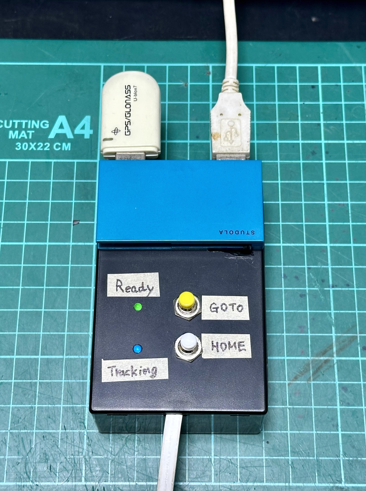
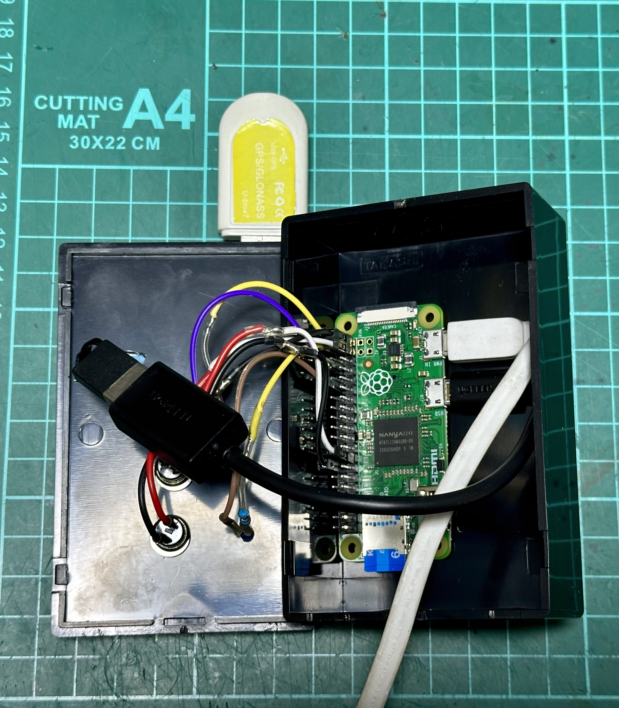

# AstroEQ用太陽自動導入コントローラー

**AstroEQ Standalone Solar GoTo Controller**

GPSで取得した位置と時刻から太陽の位置を計算し、AstroEQ赤道儀コントローラーを直接制御する、Raspberry Pi Zeroを使用した太陽専用GoToコントローラーです。

PCやASCOM、INDI、OpenAstroなどの望遠鏡制御ソフトウェアを使用せず、2個の押しボタンスイッチだけで太陽の自動導入、追尾、ホーム復帰を行います。

## 1. コントローラー外観



完成したコントローラーです。小型ケースにRaspberry Pi Zero、USB接続用の部品、2個のLED、2個の押しボタンスイッチを組み込みました。

ケース上部にはUSB GPSドングルとAstroEQ接続用のUSBケーブルを接続しています。

操作パネルには次の機能があります。

| 表示・スイッチ | 機能 |
|---|---|
| Ready（緑LED） | GPS測位が有効で、太陽が地平線より上にある場合に点灯 |
| GoTo（黄色ボタン） | 現在の太陽位置へ自動導入し、追尾を開始 |
| Tracking（青LED） | RA軸による平均太陽時追尾中に点灯 |
| HOME（白色ボタン） | 追尾を停止し、ホーム位置へ復帰 |

電源投入後、Raspberry Pi Zeroが自動起動し、GPSの測位が完了すると、太陽高度を計算してReady LEDが点灯します。

GoToボタンを押すと、赤道儀が太陽の方向へ自動的に回転し、導入完了後は平均太陽時速度で追尾します。

HOMEボタンを押すと追尾を停止し、GoTo開始前に記録したホーム位置へ復帰します。

## 2. ケース内部



ケース内部にはRaspberry Pi Zero Rev 1.3を収納しています。

GPIO端子には、Ready・Trackingの2個のLEDと、GoTo・HOMEの2個の押しボタンスイッチを接続しています。

GPS受信機とAstroEQコントローラーはUSBで接続します。Raspberry Pi ZeroのUSBデータ端子は1個なので、複数のUSB機器を接続するためにUSBハブを使用しています。

専用のプリント基板を製作せず、Raspberry Pi ZeroのGPIO端子を直接利用したシンプルな構成です。

## 3. 使用したハードウェア

| 機器 | 内容 |
|---|---|
| Raspberry Pi | Raspberry Pi Zero Rev 1.3 |
| OS | Raspberry Pi OS（32-bit） |
| GPS | u-blox 7 USB GPSドングル |
| 赤道儀コントローラー | AstroEQ |
| USBハブ | OTG接続、GPS・AstroEQ接続用 |
| LED | 緑色・青色、各1個 |
| スイッチ | モーメンタリー型押しボタン、2個 |
| 抵抗 | LED電流制限用、各330Ω |
| ケース | 小型樹脂ケース TAKACHI SW-100B |

今回のソフトウェアは、**Arduino Mega版AstroEQ**と、**MKS GEN L V2.1基板（CH340 USBシリアル変換器搭載）を使用したAstroEQ**の2種類で動作確認しています。

それぞれのUSB識別番号は以下のとおりです。

| AstroEQ構成 | USB VID:PID |
|---|---|
| Arduino Mega版 | `2341:0042` |
| MKS GEN L V2.1版（CH340） | `1A86:7523` |

プログラムはUSBデバイスを自動検出し、接続したAstroEQからファームウェア情報とモーターパラメーターを取得します。

ただし、同じCH340を搭載した基板でも構成や設定が異なる場合があるため、すべてのCH340搭載コントローラーでの動作を保証するものではありません。

## 4. Raspberry Pi ZeroのGPIO接続

GPIO番号にはBCM番号を使用します。

| 部品 | BCM GPIO | 物理ピン番号 | 接続 |
|---|---|---|---|
| Ready LED | GPIO21 | 40 | GPIO → 330Ω抵抗 → LED → GND |
| Tracking LED | GPIO20 | 38 | GPIO → 330Ω抵抗 → LED → GND |
| GoToスイッチ | GPIO22 | 15 | GPIO → スイッチ → GND |
| HOMEスイッチ | GPIO26 | 37 | GPIO → スイッチ → GND |
| 共通GND | GND | 39など | LED・スイッチ共通 |

LEDのアノード（＋）をGPIO側、カソード（−）をGND側に接続します。各LEDには電流制限抵抗を入れます。

スイッチにはGPIOの内部プルアップ抵抗を使用するため、外付けプルアップ抵抗は不要です。

スイッチを押すとGPIOがLowになり、Pythonプログラムが入力を検出します。

**注意：** Raspberry PiのGPIOは3.3V系です。GPIO端子に5Vを直接接続しないでください。また、配線作業は電源を切ってから行ってください。

## 5. Raspberry Pi Zeroのセットアップ

### 5.1 Raspberry Pi OSのインストール

Raspberry Pi Imagerを使用して、Raspberry Pi Zeroに対応した **Raspberry Pi OS Lite（32-bit、Debian 13 Trixie系）** をmicroSDカードへ書き込みます。

初期設定：

- ホスト名：`raspberrypi`
- ユーザー名：`pi`
- SSH：有効
- ネットワーク：使用環境に合わせて設定

Raspberry Pi Zero Rev 1.3はWi-Fiを内蔵していないため、USB接続のLANアダプターを使用します。

WindowsのPowerShellなどからSSH接続します。

```powershell
ssh pi@raspberrypi.local
```

以下のコマンドは、特に記載がない限りRaspberry Pi Zeroに接続されたLinuxターミナルで実行します。

### 5.2 必要なパッケージのインストール

```bash
sudo apt update

sudo apt install -y \
  python3-serial \
  python3-gps \
  python3-gpiozero \
  python3-lgpio \
  gpsd \
  gpsd-clients
```

GPS通信にはgpsd、AstroEQとのUSBシリアル通信にはpySerial、LED・スイッチの制御にはGPIO Zeroを使用します。

必要に応じて `pi` ユーザーにシリアルポートとGPIOの使用権限を付与します。

```bash
sudo usermod -aG dialout,gpio pi
```

グループ変更後は再ログインして反映させます。

### 5.3 GPSの自動認識

GPS受信機はLinuxのgpsdで管理します。

次のコマンドで設定ファイルを開きます。

```bash
sudo nano /etc/default/gpsd
```

以下の設定にします。

```ini
DEVICES=""
USBAUTO="true"
```

`DEVICES=""` とすることで、GPSのデバイス名を固定せず、udevからのUSB接続イベントによってgpsdが対応機器を登録します。

gpsdソケットを有効にします。

```bash
sudo systemctl enable --now gpsd.socket
```

GPSの通信確認：

```bash
timeout 10 gpspipe -w
```

出力されたデータにGPSのデバイス情報が表示され、`TPV` データで有効な緯度・経度・UTC時刻が取得できれば準備完了です。

今回使用したu-blox 7では、USBポートの入れ替えやGPSドングルの抜き差し後にも自動認識することを確認しました。

ただし、gpsdのudevルールが対応していないGPS受信機については、別途設定が必要になる場合があります。

## 6. Pythonスクリプトのインストール

本コントローラーは、2つのPythonファイルで動作します。

```text
/home/pi/
├── astroeq_sun_position.py
└── astroeq_sun_tracking_generic_ch340.py
```

それぞれの役割は次のとおりです。

**astroeq_sun_position.py**

GPSからUTC時刻と観測地の緯度・経度を取得し、太陽の赤経・赤緯、地方恒星時、高度・方位角を計算します。

**astroeq_sun_tracking_generic_ch340.py**

AstroEQの自動認識、モーターパラメーター取得、GoTo、追尾、HOME復帰、LED・スイッチ制御を実行します。

GitHubから取得した2つのPythonファイルを `/home/pi/` に配置します。

配置後、次のコマンドで構文を確認します。

```bash
python3 -m py_compile \
  /home/pi/astroeq_sun_position.py \
  /home/pi/astroeq_sun_tracking_generic_ch340.py
```

### 6.1 AstroEQの認識確認

モーターを駆動せずに、AstroEQのファームウェア情報とモーターパラメーターを取得できます。

```bash
python3 /home/pi/astroeq_sun_tracking_generic_ch340.py \
  --inspect-controller
```

正常に認識されると、USBデバイス情報、RA・DECのCPR、タイマー値などが表示されます。

このモードはモーター移動指令を送信しませんが、USBポートを開くことでArduinoがリセットされる場合があります。赤道儀が動作しているときには実行しないでください。

### 6.2 太陽位置計算スクリプトについて

`astroeq_sun_position.py` は、GPSから取得した時刻・位置に基づく太陽座標計算用の共通関数と、初期開発段階の計算確認用プログラムを含んでいます。

このファイルを単独実行すると、太陽の赤経・赤緯、地方恒星時、高度・方位角などを表示しますが、AstroEQへのモーター駆動指令は送信しません。

なお、単独実行時に表示されるホーム位置からのRA・DEC移動角は初期開発段階の簡略計算によるもので、実際のGoToで使用する機械座標変換とは異なります。

**実際の太陽GoTo、平均太陽時追尾、ホーム復帰には `astroeq_sun_tracking_generic_ch340.py` を使用してください。**

## 7. 電源投入時の自動起動

systemdを使い、Raspberry Pi Zeroの起動時にプログラムを自動実行します。

次のコマンドでサービス設定ファイルを作成します。

```bash
sudo nano /etc/systemd/system/astroeq-sun.service
```

設定内容：

```ini
[Unit]
Description=AstroEQ Standalone Solar GoTo Controller
Wants=gpsd.socket
After=gpsd.socket

[Service]
Type=simple
User=pi
WorkingDirectory=/home/pi
ExecStart=/usr/bin/python3 -u /home/pi/astroeq_sun_tracking_generic_ch340.py --ra-west-dir 0 --dec-south-dir 1 --execute
Restart=no
KillSignal=SIGINT
TimeoutStopSec=15

[Install]
WantedBy=multi-user.target
```

`--ra-west-dir 0` と `--dec-south-dir 1` は、今回の実機のモーター回転方向に合わせた設定です。

ほかの赤道儀に使用する場合は、そのまま適用せず、実際の回転方向を確認してください。

サービスを登録します。

```bash
sudo systemctl daemon-reload
sudo systemctl enable astroeq-sun.service
sudo systemctl start astroeq-sun.service
```

動作状態の確認：

```bash
systemctl status astroeq-sun.service --no-pager -l
```

リアルタイムログの確認：

```bash
journalctl -fu astroeq-sun.service
```

サービスが正常に起動するとGPS測位と太陽高度の確認を繰り返し、条件が成立するとReady LEDが点灯します。

なお、`Restart=no` としているため、プログラムが異常終了した場合は自動再起動しません。

異常終了後は、赤道儀の実際の姿勢とモーターの動作状態を確認してから、必要に応じて手動でサービスを再起動してください。

```bash
sudo systemctl reset-failed astroeq-sun.service
sudo systemctl start astroeq-sun.service
```

**注意：** ここで示した設定は、ユーザー名を `pi` とした新規インストール用です。実機で動作確認した環境とはユーザー名が異なるため、公開用の `pi` 環境での再検証は完了していません。

## 8. AstroEQ赤道儀コントローラーの制御方法

今回のプログラムは、AstroEQのシリアルコマンドをPythonから直接送信します。

通信速度は9600bpsです。

コマンド形式：

```text
:<command><CR>
```

正常応答：

```text
=<response><CR>
```

`<CR>` はキャリッジリターンを表します。

### 8.1 モーターパラメーターの自動取得

GoToを実行する際、AstroEQから次の情報を取得します。

| コマンド | 内容 |
|---|---|
| `e1`, `e2` | ファームウェア情報 |
| `a1`, `a2` | RA・DECのCPR |
| `b1`, `b2` | RA・DECのタイマー値 |
| `f1`, `f2` | RA・DECの動作状態 |
| `j1`, `j2` | RA・DECの位置カウンター |

CPR（Counts Per Revolution）は、赤道儀の各軸を360°回転させるためのモーターカウント数です。

今回確認した2種類のAstroEQでは、以下の値が取得されました。

| 項目 | Arduino Mega版 | MKS GEN L V1.4版 |
|---|---:|---:|
| RA CPR | 4,608,000 | 13,824,000 |
| DEC CPR | 11,712,000 | 13,824,000 |
| RAタイマー値 | 16,658 | 16,605 |
| DECタイマー値 | 16,650 | 16,605 |

これらの数値を固定値にせず、実機から自動取得することで、異なるモーターパラメーターを持つAstroEQにも対応しています。

### 8.2 高速GoToと低速位置補正

GoToでは、主に以下のコマンドを使用します。

| コマンド | 機能 |
|---|---|
| `G1xx`, `G2xx` | 動作モード・回転方向 |
| `H1`, `H2` | 移動カウント数 |
| `J1`, `J2` | 移動開始 |
| `K1`, `K2` | 停止 |

移動量は24bitのリトルエンディアン形式に変換して送信します。

例えば、RA軸を高速GoToモード、方向0で100,000カウント移動させる場合は、次のコマンドを使用します。

```text
:G100<CR>
:H1A08601<CR>
:J1<CR>
```

`A08601` は100,000を24bitリトルエンディアンで表現した値です。

高速GoTo終了後、各軸の現在位置カウンターを読み取り、目標カウントとの差を計算します。

さらに低速GoToによる補正を最大2回実行し、カウンター上の位置残差が±10カウント以内であることを確認します。

これはモーターカウンターによる位置決め精度であり、望遠鏡の光軸が天球上の目標を同じ精度で指していることを保証するものではありません。

### 8.3 太陽時追尾

GoToが完了すると、RA軸を平均太陽時速度で連続駆動します。

追尾周期は、AstroEQから読み取ったRA軸のCPRとタイマー値から次の式で求めます。

```python
period = round(freq * 86400.0 / cpr)
```

`freq` はAstroEQのタイマー値、`cpr` はRA軸のCPRです。

求めた周期を `I1` コマンドで設定します。

```python
send(ser, "G110")
send(ser, "I1" + hex24(period))
send(ser, "J1")
```

RA軸が追尾状態へ移行したことを確認するとTracking LEDが点灯します。

この追尾方式は平均太陽時速度を使用しており、太陽の赤経変化をリアルタイムに補正する高精度追尾ではありません。また、周期の整数丸めによる速度誤差があります。

例えば、Arduino Mega版AstroEQでは次の値が取得されました。

```text
RA CPR = 4608000
Timer  = 16658
```

追尾周期は、

```text
period = round(16658 × 86400 / 4608000)
       = 312
```

となります。

この設定におけるRA軸の1回転時間は、

```text
actual_day = CPR × period / Timer
           = 86306.639秒
```

となり、平均太陽時の86,400秒に対して約93.4秒短くなります。

この差は追尾周期を整数に丸めることによる設定上の速度誤差です。

## 9. 太陽導入の計算方法

**太陽の赤経・赤緯および地方恒星時はUSNO（米国海軍天文台）の近似式に基づいて計算し、赤道儀のホームからの移動角は実機に合わせて独自に変換しています。**

### 9.1 太陽位置の計算

まずGPSからUTC時刻を取得し、ユリウス日JDへ変換します。

```text
JD = Unix時刻 / 86400 + 2440587.5
d  = JD - 2451545.0
```

太陽の平均近点角gと平均黄経qを計算します。

```text
g = 357.529 + 0.98560028 × d
q = 280.459 + 0.98564736 × d
```

太陽の黄経Lは、

```text
L = q + 1.915 sin(g) + 0.020 sin(2g)
```

黄道傾斜角εは、

```text
ε = 23.439 - 0.00000036 × d
```

となります。

これらから太陽の赤経α、赤緯δを計算します。

```text
α = atan2(cos(ε) sin(L), cos(L))
δ = asin(sin(ε) sin(L))
```

三角関数の角度は度単位で扱い、Python内部では必要に応じてラジアンへ変換して計算します。

次に、USNOの近似式に基づいて地方視恒星時LSTを求め、太陽の時角HAを計算します。

```text
HA = LST - α
```

時角は西側を正、東側を負とします。

### 9.2 ホーム位置からの移動角

ホーム姿勢は、望遠鏡を天の北極方向へ向け、ウエイト軸を鉛直下にした状態です。

太陽が子午線の東側（HAが負）にある場合：

```text
RA移動角  = HA + 90°
DEC移動角 = 90° - δ
```

太陽が子午線上または西側（HAが0以上）にある場合：

```text
RA移動角  = HA - 90°
DEC移動角 = -(90° - δ)
```

この機械座標変換は、今回の赤道儀の構造とモーター方向に合わせた独自の方式です。

ここで求めた移動角の符号は、機械座標変換上の符号です。実際にAstroEQへ送信する回転方向は、各軸の方向設定に基づいて変換します。

### 9.3 モーターカウントへの変換

```text
RAカウント  = round(|RA移動角| × RA_CPR / 360)
DECカウント = round(|DEC移動角| × DEC_CPR / 360)
```

求めた移動量と回転方向をAstroEQへ送信し、太陽を導入します。

プログラムは24bit位置カウンターの差分を利用して位置補正するため、符号付き24bitの範囲で一意に扱えない移動量は拒否します。

### 9.4 ホーム位置の管理

本プログラムでは、**太陽GoToを開始する直前**にAstroEQのRA軸・DEC軸の位置カウンターを読み取り、その位置をホーム復帰の基準として記録します。

HOMEボタンを押すと、追尾を停止して両軸の停止状態を確認した後、記録したカウンター位置へ復帰します。

ホーム復帰時にも高速GoToと低速位置補正を行い、記録した位置カウンターとの差が±10カウント以内であることを確認します。

この方式はホームセンサーによる絶対位置検出ではありません。

したがって、初回のGoTo操作前には、必ず望遠鏡を天の北極方向、ウエイト軸を鉛直下にしたホーム姿勢へセットする必要があります。

また、脱調や手動操作などでモーターカウンターと実際の軸位置の対応が失われた場合、正しいホーム復帰は保証されません。

## 10. 太陽GoToを利用した極軸の簡易調整

本装置では、赤道儀の極軸が正確に合っていない場合でも、太陽GoTo機能を利用して極軸の簡易調整を行うことができます。

まず、赤道儀をホーム姿勢にセットし、GPSから計算した太陽位置へGoToします。

導入完了後、赤道儀の極軸調整用の**方位ノブと高度ノブ**を操作し、望遠鏡の視野中心に太陽を合わせます。

この操作は、位置が分かっている天体を基準に赤道儀の向きを補正するという点で、ワンスターアラインメントに似た効果があります。

ただし、通常のワンスターアラインメントは主にソフトウェア上の導入誤差を補正するものであり、極軸そのものを機械的に調整するものではありません。

また、太陽1点を中心に合わせるだけでは、極軸の方位誤差と高度誤差を完全には取り除けません。

そのため、この方法は正確な極軸合わせではなく、**太陽観測を目的とした簡易調整**として位置付けています。

長時間の追尾では、残った極軸誤差によって太陽像が視野内を移動する可能性があります。

なお、この調整は必ず適切な太陽観測用フィルターや安全な撮像装置を使用して行ってください。

## 11. 安全上の注意

太陽へのGoToは、使用する望遠鏡に適切な太陽観測用フィルター、遮熱設備、安全な撮像方法が準備されている場合に限って実行してください。

太陽観測用の適切な装備を持たない望遠鏡を太陽へ向けないでください。太陽を直接のぞくことは非常に危険です。

また、本プログラムは赤道儀の機械的な衝突を検出する専用センサーを備えていません。

モーターカウンターを基準に動作するため、脱調、手動操作、電源断などによって、実際の赤道儀姿勢と内部カウンターの対応が失われる場合があります。

初回使用時には、モーター回転方向、可動範囲、ホーム姿勢を安全な条件で確認する必要があります。

また、GoTo開始前にAstroEQの各軸が停止状態であることを確認します。動作中の軸が検出された場合は、予期しないGoToを防ぐため、移動を開始せずエラーとします。

ただし、ソフトウェア上の状態確認だけで、実際の機械的安全性を保証することはできません。

### 11.1 スイッチ操作の制限

GoToボタン（SW1）は待機中のみ有効です。太陽GoToの実行中および追尾中は受け付けません。

HOMEボタン（SW2）は、太陽GoToが完了して追尾を開始した後に有効になります。高速GoTo中や低速位置補正中の緊急停止ボタンとしては機能しません。

異常発生時にはソフトウェアからAstroEQへ停止指令を送信しますが、通信障害などによって停止できない場合があります。緊急時には、赤道儀を安全に停止できる独立した手段を確保してください。

## 12. 現在の制限と今後の課題

本プログラムは実験・開発用として公開するものであり、すべてのAstroEQコントローラーでの動作を保証するものではありません。

現時点で未検証、または未実装の項目には、以下があります。

- 長期間の連続運転における安定性
- 太陽像を用いた追尾精度の定量測定
- 他機種GPS受信機との互換性
- ホームセンサーによる絶対位置検出
- 機械的な衝突の自動検出
- 太陽像の位置を利用した自動追尾補正

### 実機動作確認

2026年11月15日、Arduino Mega版AstroEQで連続動作試験を行いました。

| 項目 | 結果 |
|---|---|
| GPS測位・太陽位置計算 | 正常 |
| AstroEQの自動認識 | 正常 |
| モーターパラメーター取得 | 正常 |
| GoToボタン入力 | 3回連続成功 |
| 高速GoTo | 3回連続成功 |
| 低速位置補正 | 3回連続成功 |
| 太陽時追尾開始 | 3回連続成功 |
| HOMEボタン入力 | 2回連続成功 |
| HOME復帰 | 2回連続成功 |

GoTo後のモーターカウンター残差は各軸で±1カウント、HOME復帰後の残差は各軸で−1カウントでした。

これにより、今回の実機構成では、太陽GoTo、追尾、HOME復帰を繰り返し実行できることを確認しました。

ただし、光学的な太陽導入精度や長時間追尾精度は、このカウンター試験だけでは評価できません。

## 13. ライセンス

本プロジェクトの独自Pythonソースコードは、**MIT License** で公開します。

詳細は [LICENSE](LICENSE) を参照してください。

### Third-party references / 参考プロジェクト

**AstroEQ — Thomas Carpenter**

https://github.com/TCWORLD/AstroEQ

本プロジェクトは、AstroEQ赤道儀コントローラーのシリアル通信プロトコルを利用した独立したPythonプログラムです。

AstroEQのファームウェアおよび公式ソフトウェアは本リポジトリに含まれず、それらには元のプロジェクトのライセンスが適用されます。

**United States Naval Observatory（USNO）**

https://aa.usno.navy.mil/faq/sun_approx

https://aa.usno.navy.mil/faq/GAST

太陽の赤経・赤緯および地方恒星時の計算には、USNOが公開している天文計算の近似式を利用しています。

**Python libraries**

- pySerial
- GPIO Zero
- gpsd / Python GPS interface

これらのライブラリは個別のライセンスに従います。本リポジトリのMIT Licenseは、各ライブラリのライセンスを変更するものではありません。

## 14. 参考資料

**USNO（United States Naval Observatory）**

Computing Approximate Solar Coordinates

https://aa.usno.navy.mil/faq/sun_approx

Computing Approximate Sidereal Time

https://aa.usno.navy.mil/faq/GAST

**Raspberry Pi Documentation**

https://www.raspberrypi.com/documentation/

---

本装置は、Raspberry Pi ZeroとAstroEQを使用し、シンプルな操作で太陽を導入・追尾することを目的として製作したものです。

AstroEQの直接制御方法と太陽位置計算のPythonコードを公開することで、自作赤道儀や天体観測用制御装置の開発に役立てられればと考えています。
